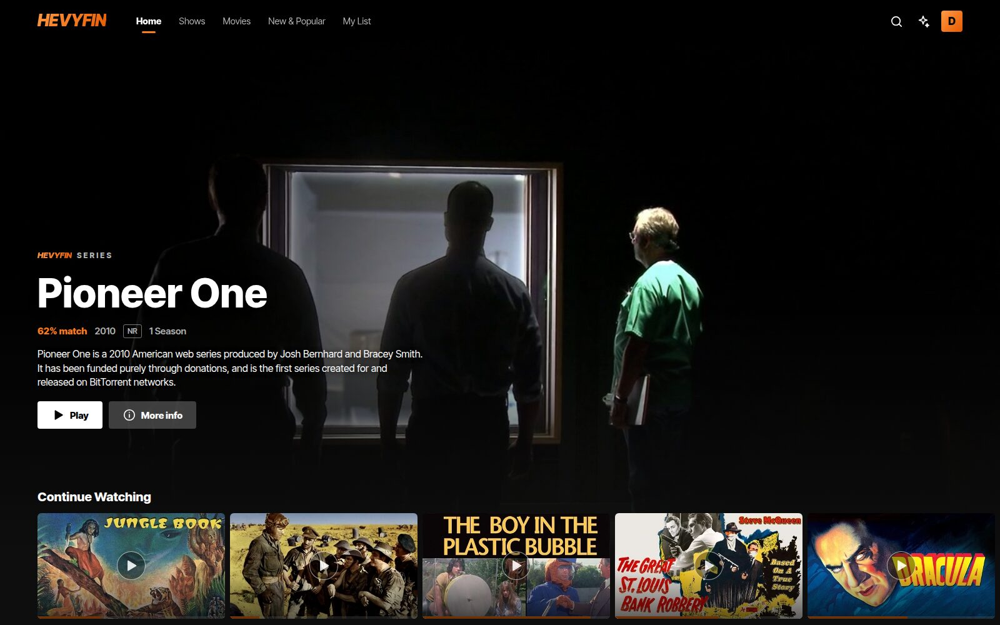
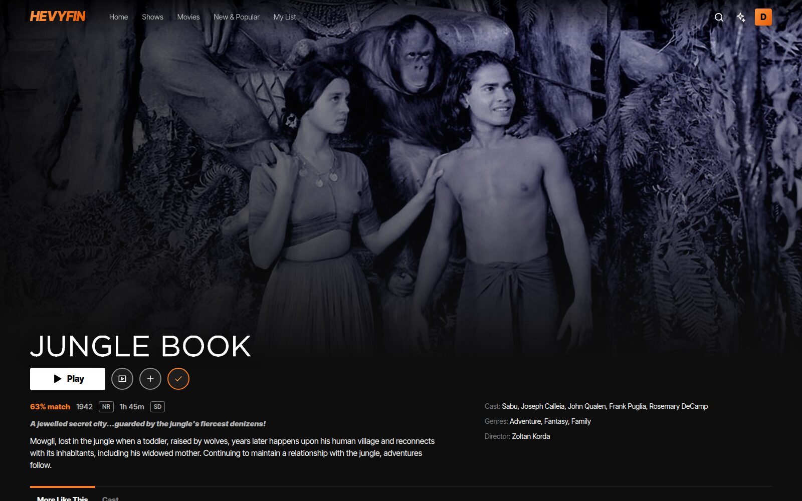
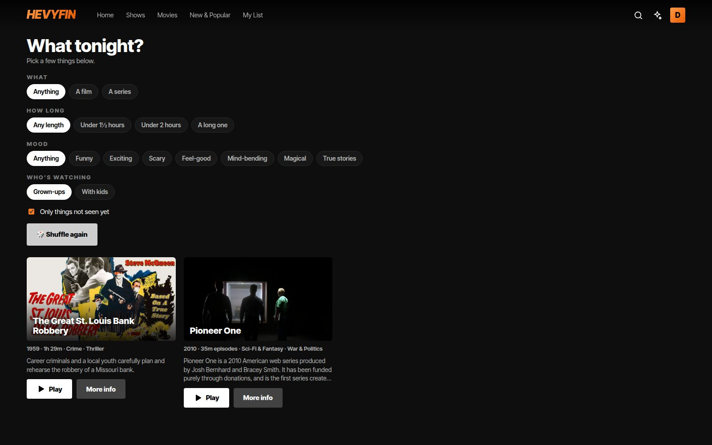

# Hevyfin

**A free, streaming-service-style client for [Jellyfin](https://jellyfin.org), with requests built in.**
Black and orange, poster rows and a big billboard, an mpv player, a TV app with a cinema and
channels, and [Seerr](https://github.com/seerr-team/seerr) requests right next to your library.

[](LICENSE)



| | |
|---|---|
|  |  |
|  | |

<sub>Screenshots: the browser version against Jellyfin's public demo server (public-domain films).</sub>

## Supported platforms

| Platform | Status |
|---|---|
| **Linux** (x86_64) | ✅ Supported: built and used daily on Fedora / Bazzite. Needs libmpv (the install script bundles it). |
| **Android** phones and tablets (arm64) | ✅ Supported |
| **Android TV / Google TV** (e.g. Chromecast with Google TV) | ✅ Supported: remote-friendly TV layout, Cinema, channels, screensaver |
| **Web**, desktop Firefox and Chrome | ✅ Supported, self-hosted (Flutter web build, or the lighter Vue browser version). Phones get a page to download the Android app. |
| **Windows** | ⚠️ Not yet: the project files are there but it has never been built or tested. Help welcome! |
| **macOS, iOS** | ❌ Not supported |

## Features

- **Home**: a billboard plus rows for Continue Watching, Next Up, New, "Because you watched…",
  Top 10 movies and shows, seasonal rows and genres.
- **Requests** (optional, with Seerr): suggestions next to your library ("More like X: request
  it", Trending), a show's missing seasons, and **New & Popular** to browse TMDB and follow your
  requests with download progress. One sign-in: Seerr uses the same Jellyfin account.
- **Player**: mpv (via media_kit) with hardware decoding. Resumes where you left off, audio and
  subtitle pickers, subtitle styles, skip intro (with media segments), autoplaying next
  episode, sleep timer, picture-in-picture.
- **What tonight?**: pick what, how long, a mood and who's watching, and get three ideas from
  your library. Optionally ask in your own words through a recommendation service you run
  ([docs/niql.md](docs/niql.md)).
- **Profiles**: "Who's watching?" with optional PINs, and sign a TV in with a Quick Connect code.
- **Collections and universes**: franchise collections with a story order, chapters and a
  custom page ([docs/custom-collections.md](docs/custom-collections.md)).
- **TV**: **Cinema** screenings with trailers, a countdown and an intermission, **Cinema mode**
  for a private screening, **marathons**, four **house channels** built from your library on a
  24-hour schedule, **Free TV** from Jellyfin Live TV with a guide, and a screensaver
  ([docs/tv-channels.md](docs/tv-channels.md)). No ads, ever.
- **Watch together** (Jellyfin SyncPlay) and **Play on TV** (remote control).
- **Downloads** for offline viewing on Android and Linux.
- **Hevyfin Admin** (`admin/`): a web panel for your server's admins: people, requests, who's
  watching, server health ([docs/admin.md](docs/admin.md)).

Hevyfin talks only to **your own** Jellyfin (and Seerr) server. It has no accounts, analytics
or tracking.

## Getting started

1. Have a [Jellyfin](https://jellyfin.org/downloads) server with your media (and, if you like,
   [Seerr](https://github.com/seerr-team/seerr) for requests).
2. Get Hevyfin: an APK from the [releases](https://github.com/NickHemeryckeHevan/hevyfin/releases),
   or build it yourself ([docs/building.md](docs/building.md)):
   ```sh
   flutter pub get
   ./scripts/install-linux.sh                           # Linux
   flutter build apk --release --split-per-abi          # Android / Android TV
   ```
3. Sign in with your server's address (e.g. `http://192.168.1.10:8096`) and your Jellyfin
   account. You can add a second address for when you're away (a VPN, say). Seerr is looked
   for on the same host, port 5055. Change that in Settings if yours is elsewhere.

## Documentation

| | |
|---|---|
| [docs/building.md](docs/building.md) | Building for Linux, Android, web; signing; tests |
| [docs/self-hosting-web.md](docs/self-hosting-web.md) | Hosting the web version (nginx container) |
| [docs/tv-channels.md](docs/tv-channels.md) | Cinema, trailers, house channels (and making your own), Free TV channels |
| [docs/custom-collections.md](docs/custom-collections.md) | Universes, story order, custom collection pages, credits scenes |
| [docs/niql.md](docs/niql.md) | Plugging in your own "What should I watch?" service |
| [docs/admin.md](docs/admin.md) | Hevyfin Admin |
| [server/README.md](server/README.md) | Optional server-side helper scripts |

## License

Hevyfin is free software under the **[GNU General Public License v3.0 or later](LICENSE)**.
You may use, study, share and change it. If you distribute it or anything based on it, you must
do so under the same license and share the source code, so every fork stays open source.

Third-party parts keep their own licenses: see [THIRD_PARTY_NOTICES.md](THIRD_PARTY_NOTICES.md).

## Disclaimer

Hevyfin is an independent project and is **not affiliated with or endorsed by Jellyfin,
Netflix, Seerr, TMDB or anyone else** whose service it works with. It comes with **no media,
streams or indexers**: you are responsible for having the rights to what you play, stream or
download. It is provided **as is, without any warranty**. Read the full
**[DISCLAIMER.md](DISCLAIMER.md)**.

This product uses the TMDB API but is not endorsed or certified by TMDB.

## Contributing

Issues and pull requests are welcome: see [CONTRIBUTING.md](CONTRIBUTING.md).
